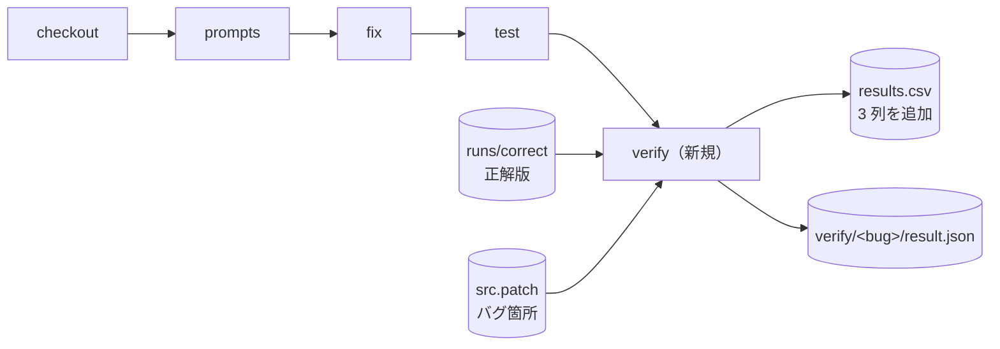
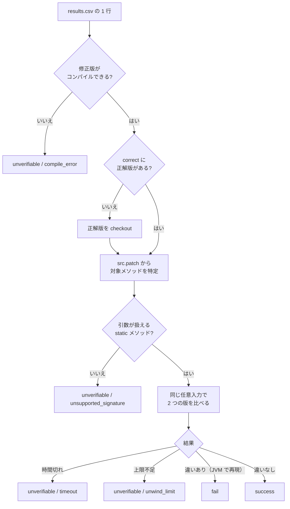

# ADR 0002: JBMC による過学習パッチ検出（`verify` 手順）

- 状態: 採用
- 日付: 2026-11-03
- 置き換え: [ADR 0001](0001-esbmc-existing-tests-trial.md)

## 背景

パイプライン（`workspace/pipeline.py`）は `checkout → prompts → fix → test` で、修正の評価は `defects4j test` の合否だけだった。テストに通っても実は誤っている修正（過学習パッチ）は見つけられない。

ADR 0001 の試行では、ESBMC の Java 対応の狭さに加えて、既存テストと同じ入力ではテスト以上の情報が得られないことがわかった。

## 目的・成功条件・非対象

| 区分 | 内容 |
| --- | --- |
| 目的 | 修正版と正解版に**同じ任意の入力**を与えて比べ、テストでは見つからない誤りを見つける |
| 成功条件 | `results.csv` の全行を `success` / `fail` / `unverifiable` に分類して書き込む。検査できない行にも理由を付ける。LLM は使わない |
| 非対象 | ESBMC、インスタンスメソッド、オブジェクト型の引数、副作用（引数の配列などの書き換え）の比較、例外メッセージの比較 |

## 決定事項

| # | 決定 | 理由 |
| --- | --- | --- |
| 1 | テストに通った修正の誤り（過学習パッチ）の検出に使う。検査は**全行**に対して行う | テストと同じ入力の検査では新しい情報が得られない。全行を分類しておけば後から分析できる |
| 2 | 検査ツールは **JBMC だけ**を使う | Java 用の検査器で、`long`/`double`、文字列、例外、標準ライブラリにある程度対応している |
| 3 | パイプラインに手順 `verify` を追加する（`steps: [checkout, prompts, fix, test, verify]`） | `test` と分けて実行でき、終わった実験フォルダにも後から実行できる |
| 4 | 正解版と修正版のメソッドに同じ任意の入力を与える。**返り値が異なるか、例外の種類が異なれば `fail`** とする | 正解版は Defects4J から機械的に取得できる。例外のメッセージは書き方の違いにすぎないことが多い |
| 5 | 比べるのは**開発者が修正したメソッド（バグ箇所）だけ**。LLM がそれ以外のメソッドも変更したかは JSON に記録する | 後から誤判定を確認できるようにする |
| 6 | 任意の値を与える入力は、**引数が `int`・`boolean`・`String` とそれらの配列だけの static メソッド**に限る。それ以外は `unverifiable` | オブジェクトの中身を任意にすると、ありえない状態から誤った `fail` が出るおそれがある |
| 7 | 時間切れは `unverifiable`（`timeout`）、ループの上限不足も `unverifiable`（`unwind_limit`）とする。**上限が足りたうえで違いがない場合だけ `success`** | 「わからない」を `success` に数えない |
| 8 | コンパイルできない修正は `unverifiable`（`compile_error`） | JBMC に渡せないため |
| 9 | 正解版は `workspace/runs/correct/` に保存し、**まだ存在しない場合だけ checkout** する。3 方式で共用する | checkout が 1 回で済み、どの比較でも同じ正解版を使える |
| 10 | バグ箇所のメソッドは `src.patch` から求める。バグ版は checkout しない | 差分ファイルから機械的に求められる |
| 11 | 1 件あたりの時間の上限は 300 秒で、ループの上限確認（unwinding assertion）を有効にする | 103 件 × 3 方式を現実的な時間で終える |

### 採用しなかった案

- **ESBMC を使う**: Java の型やライブラリへの対応が狭い（ADR 0001）。
- **既存テストの入力で検査する**: テストと同じ結果になり、新しい情報が得られない（ADR 0001）。
- **テストに通った行だけを検査する**: 全行を分類して後から分析する方針にしたため。
- **オブジェクトの中身も任意の値にする**: 誤った `fail` が出るおそれがあるため、最初の段階では採用しない。
- **`verify_bounded` 列を作る**: 上限が足りたことを `success` の条件にしたため不要。使った上限は JSON に記録する。

## 設計

### 1 行ごとの処理

### 出力

`results.csv` に追加する列:

| 列名 | 値 |
| --- | --- |
| `verify_status` | `success` / `fail` / `unverifiable` |
| `verify_reason` | `fail` または `unverifiable` の理由（下表） |
| `verify_time_sec` | 検査にかかった時間（秒） |

`verify/<Project>-<id>/result.json` に記録するもの:

- `targets`: 比べたメソッド
- `methods[]`: メソッドごとの結果。状態、理由、反例の入力と JVM での再現結果、使ったループの上限、JBMC の各実行（`attempts`）、JVM で再現しなかった反例（`spurious_counterexamples`）を含む
- `jbmc`: JBMC のバージョン、ループの上限、文字列や配列の長さの上限、メモリと時間の上限
- `llm_changes`: LLM がバグ箇所以外のメソッドやメソッド外を変更したか
- `logs`: ログの場所。JBMC の JSON 出力と、実行したコマンドが入る
- `developer_added_methods` / `developer_removed_methods`: 開発者が追加・削除したメソッド。両方の版にないため比べられない

`verify_reason` の値:

| 値 | 状態 | 意味 |
| --- | --- | --- |
| `return_mismatch` | fail | 同じ入力で返り値が異なる（JVM で再現済み） |
| `exception_mismatch` | fail | 同じ入力で例外の有無または例外のクラスが異なる（JVM で再現済み） |
| `not_found` | unverifiable | 修正版の checkout がない |
| `compile_error` | unverifiable | 修正版がコンパイルできない |
| `checkout_error` | unverifiable | 正解版の checkout に失敗した |
| `patch_error` | unverifiable | `src.patch` を読めない、または正解版に適用できない |
| `no_target_method` | unverifiable | 両方の版にある修正メソッドがない |
| `unsupported_signature` | unverifiable | コンストラクタ、インスタンスメソッド、または扱えない引数や返り値の型 |
| `target_missing` | unverifiable | 修正版に同じ static シグネチャのメソッドがない |
| `correct_compile_error` | unverifiable | 正解版がコンパイルできない |
| `harness_error` | unverifiable | 検査用のハーネスがコンパイルできない |
| `jbmc_error` | unverifiable | JBMC がエラーで止まった |
| `unexpected_property` | unverifiable | ハーネス以外の検査項目で JBMC が止まった |
| `memory_limit` | unverifiable | JBMC がメモリの上限を超えた |
| `timeout` | unverifiable | 時間の上限を超えた |
| `unwind_limit` | unverifiable | ループの上限を最大まで上げても足りなかった |
| `spurious_counterexample` | unverifiable | JBMC の反例が JVM で再現せず、除外して再検査しても決着しなかった |
| `unconfirmed_counterexample` | unverifiable | JBMC の反例を読み取れない、または JVM で確かめられなかった |
| `internal_error` | unverifiable | 想定外の例外（`result.json` の `error` に詳細） |

1 件に複数の対象メソッドがある場合は、1 つでも `fail` なら `fail` にする。`fail` がなく `unverifiable` があれば `unverifiable` にし、理由は上の表の順で最初のものを使う。すべて `success` の場合だけ `success` にする。

## 実装上の決定

設計段階で「仕様書で具体化すること」とした項目について、実装で次のように決めた。

### 同じ名前のクラスを持つ 2 つの版を同時に読み込む

- 正解版のクラスをすべて `jbmcverify/correct/` 以下に名前を付け替え、修正版はそのまま使う。外部ライブラリは不要なので、JDK 11 内蔵の ASM（`jdk.internal.org.objectweb.asm`）を使う（`verify_support/ClassRewriter.java`）。
- ハーネスは別のパッケージから呼び出す。そのため、対象クラス、その外側のクラス、対象メソッドは、両方の版で public に書き換える。修正版は、書き換えたクラスだけを別のディレクトリに置き、classpath の前に並べる。
- 例外の種類は `CProver.classIdentifier` で比べ、付け替えた接頭辞を取り除く。`getClass()` は JBMC のモデルで誤った違いを出したため使わない。

### 対象メソッドの特定

- `src.patch` は「正解版 → バグ版」の差分である。正解版の `-` 行と、バグ版（正解版に差分を適用して作る）の `+` 行を含むメソッドを tree-sitter で求める。
- 対象は、両方の版に存在するメソッドだけにする。無名クラスやローカルクラスの中のメソッドは除く。
- 引数の型は `int`・`boolean`・`String` とそれらの 1 次元配列に限る。返り値の型は、プリミティブ型、そのラッパー型、`String`、それらの 1 次元配列、`void` を扱う。

### 検査用のハーネス

- `VerifyHarness.check(<引数>)` を JBMC の入口にする。JBMC は引数に任意の値を与える（参照型には `null` も含む）。
- 配列は版ごとに複製して渡す。メソッドが配列を書き換えても、もう一方の版の入力に影響しない。
- 例外の種類の一致と返り値の一致を、それぞれ別の `assert` にする。浮動小数点は `==` で比べ、両方が NaN の場合も等しいとみなす。

### JBMC の実行

- `--stop-on-fail --trace` で最初の違反だけを探す。検査項目ごとに解くと、gcd でも 300 秒を超えたためである。
- ループの上限は 8 から始め、16 → 32 → 64 と倍にする。上限の確認を有効にした実行（full）で上限不足だけが出た場合は、上限の確認を無効にした実行（bounded）で、その上限内に違いがないかを先に探す。
- JBMC 6 は上限の確認を既定で有効にするため、bounded の実行では `--no-unwinding-assertions` を明示する。
- 任意の文字列の長さは 6、配列の長さは 4 まで（`--max-nondet-string-length` / `--max-nondet-array-length`）。
- メモリは `ulimit -v` で 4096 MB に制限する。超えた場合は `memory_limit` にする。
- 300 秒は 1 件全体の上限である。対象メソッドが複数ある場合は、残り時間を均等に分ける。

### 反例の JVM での確認

- JBMC の反例から入力値を読み取り、同じ入力で 2 つの版を JVM で実行するプログラムを生成して確かめる。
- 再現した場合だけ `fail` にする。JBMC のモデル（例外メッセージの組み立て、浮動小数点の関数など）が原因の誤った反例で `fail` にしないためである。
- 再現しない反例は記録する。引数が `int`・`boolean`・`String` だけの場合は、その入力を `CProver.assume` で除外して再検査する（最大 3 回）。

### 正解版の保存

- 正解版は `<correct_dir>/<Project>-<id>/` に `defects4j checkout -v <id>f` で取得する。
- 完了の印は、隣に置く `<Project>-<id>.complete`（JSON）である。印のないディレクトリは途中で止まったものとみなし、削除して取り直す。
- 正解版の中身は書き換えない。コンパイルは作業ディレクトリ（`verify/<bug>/.work/`）にコピーしてから行う。

### パイプラインへの組み込み

- `pipeline.py verify --dir <run_dir> [--bugs ...]` を単独で実行できる。plan の `steps` にも `verify` を書ける。
- `checkout` を含まない plan は、既存の実験フォルダ（`out_dir`）に後から実行するものとみなす。このとき `out_dir` は存在している必要がある。`run_all_results.txt` は上書きせず追記する。
- `verify` は選んだ行の 3 列を最初に空にし、1 行終わるごとに `results.csv` を書き直す。

## 前提・リスク

- `success` は「上の上限の範囲で、ループの上限も足りている状態で、違いが見つからなかった」という意味である。完全に正しいことを示すものではない。
- 対象を static メソッドと単純な型に限るため、`unverifiable` が多くなる見込みである。その件数と理由の内訳も研究結果として扱う。
- JBMC は、`String` を多く扱うメソッドで文字列ソルバのメモリを大きく使う（Lang-41 では、上限 4・文字列長 3 でも 6 GB を超えた）。`long` の乗除算を繰り返すメソッドでも同様である（Math-92 の `binomialCoefficient` は上限 8 で 6 GB を超えた）。こうしたメソッドは `memory_limit` になりやすい。
- 浮動小数点の関数（`Math.log`、`Math.floor` など）は JBMC のモデルが不正確で、誤った反例が出やすい。この場合は JVM での確認で除外され、`spurious_counterexample` になる。
- 正解版と異なる方法でも正しい修正（例外の種類だけが違う、など）が `fail` になる可能性がある。`result.json` の反例から後で確認する。
- LLM がバグ箇所以外のメソッドを変更した場合、その変更は比べないため、誤りを見逃す可能性がある。`llm_changes` から後で確認する。
